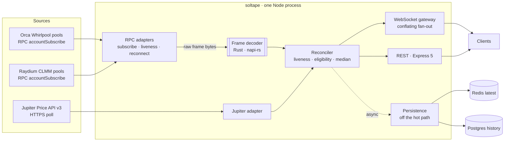

<!-- @spec DLV-RDM-001, DLV-RDM-002 -->
# soltape

[](https://github.com/hmalladi3/soltape/actions/workflows/ci.yml)

A real-time Solana market-data service that turns several price sources into one reliable feed. It decodes Orca Whirlpool and Raydium CLMM pool accounts straight from on-chain data, adds Jupiter's aggregated price, reconciles them into one consolidated USDC price per token with source attribution, and serves it over REST and WebSocket. Every input is checked for staleness, every exclusion has a reason, and latency is measured at every stage. The service is Node/TypeScript end to end; one CPU-bound component, the frame decoder, is Rust, loaded as a native addon via napi-rs.



## Quickstart

Requires only Docker. No accounts, keys or credentials.

```sh
docker compose up
```

Open <http://localhost:8080> for the live page, or:

```sh
curl localhost:8080/price/SOL        # consolidated price
curl localhost:8080/sources/SOL      # every source, with why it is or isn't counted
curl localhost:8080/health
```

This pulls the prebuilt multi-arch image (`ghcr.io/hmalladi3/soltape`) and reads live mainnet through the free public Solana RPC. Jupiter needs a free API key: set `JUPITER_API_KEY` to enable it; without it the service runs on the two on-chain venues and reports Jupiter as *not configured*. Port 8080 taken? `SOLTAPE_PORT=8090 docker compose up`. To build from source instead: `docker compose build`.

## Offline mode

```sh
docker compose --profile replay up
```

The same service, unchanged, reads a recorded mainnet session served by a local replay server that speaks Solana JSON-RPC and the Jupiter API. No network needed after the image pull, and it works when the public RPC is rate-limited or down. The committed recording holds 414 account notifications captured on 2026-10-19, each verified against both decoders and the official Orca and Raydium SDKs.

## Break it

With the offline mode running, inject faults into the replay server and watch the live page and `/health` react:

```sh
curl -X POST localhost:8899/control -d '{"op":"drop","venue":"orca"}'              # disconnect a venue
curl -X POST localhost:8899/control -d '{"op":"stall","venue":"raydium"}'          # connected but silent
curl -X POST localhost:8899/control -d '{"op":"garbage","venue":"orca","rate":0.3}' # malformed frames
curl -X POST localhost:8899/control -d '{"op":"jupiter","status":429}'             # rate-limit Jupiter
curl -X POST localhost:8899/control -d '{"op":"restore","venue":"*"}'              # heal everything
```

A dropped venue is excluded immediately (`source_down`), a silent one within about 2 s (`source_stale`, from its slot stream), and malformed frames are rejected and counted without affecting the rest. When a source comes back it must stay live for 1 s before it counts again. Losing every source of a token returns `503` with the last known price; losing Redis or Postgres changes nothing on the live feed.

## Latency

<!-- RESULTS:START -->
Full matrix on a GitHub-hosted runner (`ubuntu-24.04`, 4 vCPU AMD EPYC 7763, Node 24), **with Redis and Postgres running** (production-like). The replay server, the service and the load-client processes all share the 4 vCPUs. Commit `9377b29`, [bench workflow run](https://github.com/hmalladi3/soltape/actions/runs/39650914440). Replay of real recorded frames, open-loop, 10 s warmup then 30 s measured per cell.

| Load | Subs | e2e p50 | e2e p99 | internal p50 | internal p99 | event-loop p99 | conflated | service CPU |
|---:|---:|---:|---:|---:|---:|---:|---:|---:|
| 1,000/s | 1 | 150 µs | 1.38 ms | 25 µs | 41 µs | 0.92 ms | 0% | 15% |
| 5,000/s | 1 | 154 µs | 10.2 ms | 27 µs | 41 µs | 2.2 ms | 0% | 61% |
| 10,000/s | 1 | 194 µs | 10.8 ms | 30 µs | 53 µs | 5.0 ms | 0% | 94% |
| 20,000/s | 1 | 404 µs | 15.0 ms | 17 µs | 51 µs | 6.9 ms | 0.07% | 95% |
| 50,000/s | 1 | 32.8 ms | 78.5 ms | 9 µs | 36 µs | 52.7 ms | 64% | 103% |
| 1,000/s | 100 | 1.32 ms | 3.67 ms | 40 µs | 80 µs | 2.1 ms | 0% | 94% |
| 5,000/s | 100 | 2.15 ms | 19.3 ms | 25 µs | 79 µs | 7.9 ms | 0% | 97% |
| 10,000/s | 100 | 19.1 ms | 60.8 ms | 28 µs | 78 µs | 55 ms | 0.12% | 75% |
| 20,000/s | 100 | 54.2 ms | 99.0 ms | 12 µs | 57 µs | 79 ms | 56% | 87% |
| 1,000/s | 1,000 | 25.3 ms | 53.2 ms | 124 µs | 478 µs | 40 ms | 0% | 86% |
| 5,000/s | 1,000 | 315 ms | 558 ms | 26 µs | 241 µs | 412 ms | 69% | 89% |

How to read it:
- **Internal** latency (frame receipt to the last WebSocket write inside the service) stays at tens of microseconds across the whole matrix.
- **End-to-end** adds the replay server's socket, the client's receive and, mostly, three processes contending for 4 shared vCPUs. It is measured from each frame's *intended* send time, so stalls are charged in full.
- The **ceiling is one event loop**: the service reaches about 95% of a core at 10–20k updates/s with one subscriber, or about 100k messages/s of fan-out (1k/s × 100 subscribers). Past that, conflation takes over by design: memory stays bounded and clients converge on the latest price, but intermediate updates are skipped.
- Cells at 50k/s × 100 and at 10k–50k/s × 1,000 are fully saturated; they're in the [run's job summary](https://github.com/hmalladi3/soltape/actions/runs/39650914440).

**Frame decoder** (same runner, real mainnet frames, latency under GC pressure):

| Decoder | Frames/s | p50 | p99 | p99.9 |
|---|---:|---:|---:|---:|
| Rust (napi-rs) | 492,200 | 2.38 µs | 2.58 µs | 11.1 µs |
| TypeScript reference | 122,200 | 9.36 µs | 18.9 µs | 31.3 µs |

Two profiling-driven optimizations got here; each was measured against an A/A noise floor on the runner, and both are recorded in [`docs/perf.md`](docs/perf.md):
- **WebSocket fan-out:** framing each update once and corking sockets per event-loop turn cut CPU per update by 80% when updates share a turn. 100 subscribers at 1k/s went from collapse to healthy.
- **History writes:** moving off the ORM's per-value insert builder cut event-loop CPU per 2,000 rows from 34 ms to 2.7 ms. At 10k/s with one subscriber, the event-loop p99 dropped from 67 ms to 5 ms and conflation from 12% to 0.
<!-- RESULTS:END -->

Every push runs a reduced benchmark on a GitHub-hosted runner and publishes it in the [CI job summary](https://github.com/hmalladi3/soltape/actions/workflows/ci.yml). Shared runners are noisy, so those numbers are a regression signal (the job fails above 5× a committed baseline), not the headline.

## Run the benchmark

```sh
docker compose --profile bench run --rm bench     # full matrix inside the image; results in ./bench/results
```

Or on the host with Node 24 and pnpm: `pnpm install && pnpm bench` (add `-- --quick` for the reduced matrix), and `pnpm bench:decoder` for the decoder microbenchmark.

The benchmark starts the replay server in rate mode, the service as a production build, and several load-client processes. The replay server emits real recorded account frames (cloned into synthetic markets, each with a nudged price so every frame changes the price) on an open-loop schedule and logs each frame's *intended* send time. End-to-end latency is client receive time minus that intended time, so a stalled service cannot slow the load down and hide its own stall. Inputs that never reach a client are counted as conflated, separately from latency. The *knee* is the lowest rate where e2e p99 exceeds 1 ms, conflation exceeds 1%, or event-loop delay p99 exceeds 1 ms.

## How it works

- **Rust only where CPU is the bottleneck.** The RPC adapter hands each raw WebSocket frame to the native decoder, which parses the JSON-RPC envelope, base64-decodes the account, identifies the layout by Anchor discriminator and reads the price fields in one pass, with zero heap allocations (enforced by a test). A TypeScript reference decoder implements the same contract and matches it bit for bit on recorded frames, fuzzed inputs and JSON edge cases; it is the fallback if the addon is missing and the baseline that justifies the Rust.
- **Staleness means unproven liveness, not an unchanged price.** A quiet pool's price is still correct as long as we can prove we would have heard about a change, so liveness comes from each venue's slot stream on the same connection, with a hard per-observation expiry and periodic re-reads of quiet pools as backstops.
- **Median with outlier rejection.** One wrong source out of three cannot move the price; two diverging sources are kept and flagged rather than guessing. Every exclusion has a reason code.
- **Conflate, never queue.** A slow WebSocket client gets the newest price per token when it drains, not a backlog. Per client, memory is bounded by the 256 KiB high-water mark plus one pending frame per token (about 256 MiB worst case at 1,000 clients); clients congested for 10 s are disconnected.
- **Persistence is off the hot path.** The WebSocket push happens first. Redis gets a coalesced latest-value snapshot for warm restarts; Postgres gets batched history in daily partitions dropped at the retention boundary.
- **Prices are in USDC, not "USD".** Jupiter's USD prices are converted with its own USDC price, so a depeg is visible instead of hidden. Tokens without a deep USDC pool are priced through SOL, with both legs named in the attribution.
- **Depth** (`size` in `/sources`) is an estimate of the quote amount needed to move a pool's price by 1%, computed from its current active liquidity. It assumes no tick boundary is crossed, so treat it as an order-of-magnitude figure, not a guaranteed fill size.

## API

| Endpoint | Returns |
|---|---|
| `GET /price/:mint` | Consolidated price, sources, exclusions with reasons, spread, flags, slot, `seq`. `503` with `lastKnown` when no source is eligible. `:mint` accepts a base58 mint or a symbol (`SOL`). |
| `GET /sources/:mint` | Every configured source: price, depth, slot, age, eligibility and reason; route legs. |
| `GET /history/:mint?window=1h&bucket=1m` | OHLC buckets from Postgres history. |
| `GET /mints` · `GET /health` · `GET /stats` · `GET /metrics` | Markets; health with per-source state; live latency percentiles; Prometheus metrics. |
| `WS /ws` | `{"op":"subscribe","mints":["SOL"]}` or `["*"]`; pushes `snapshot`, `price` (with `trigger`) and `unavailable` messages. |

## Configuration

| Variable | Default |
|---|---|
| `RPC_HTTP_URL`, `RPC_WS_URL` | public mainnet endpoints (point these at a dedicated RPC for per-slot updates) |
| `JUPITER_API_KEY` | unset (Jupiter disabled) |
| `PORT` | `8080` |
| `REDIS_URL`, `DATABASE_URL` | the compose services; both optional |
| `DECODER` | `auto` (native, else TypeScript) |
| `HISTORY_RETENTION_DAYS` | `7` |

Markets live in [`config/markets.json`](config/markets.json): SOL, JUP, JTO, BONK and WIF, each priced by the highest-TVL path on Orca and Raydium, verified on-chain at startup (a wrong pool address is a startup error, never a silently wrong price).

## Known limits

- **The free public RPC throttles account notifications.** Measured: a handful per pool per 15 s for pools that trade several times a second. Live mode on it updates every few seconds; slot streams, snapshots and re-reads keep it correct. The latency numbers come from replay.
- **One event loop is the ceiling.** About 10–20k updates/s, or about 100k fan-out messages/s, on a shared 4-vCPU runner. Beyond that, conflation takes over: clients still converge on the latest price, but intermediate updates are skipped. Going further means spreading WebSocket subscribers across processes.
- `processed` commitment by default: fastest, and very rarely reflects a slot that is later skipped. This is a market-data feed, not an oracle.

## Development

```sh
pnpm install
pnpm build            # TypeScript (tsc -b) — the native addon is built by `pnpm build:native` (needs Rust)
pnpm test             # unit + integration (integration needs Docker for testcontainers)
pnpm lint && pnpm typecheck
pnpm record           # record a new mainnet session fixture (5 min)
```

Without Rust installed, everything runs on the TypeScript reference decoder.

The project follows linked-intent development: [`docs/high-level-design.md`](docs/high-level-design.md) → [`docs/llds/`](docs/llds) → [`docs/specs/`](docs/specs) (EARS requirements, cited by `@spec` comments in code and tests) → tests → code. `node bin/coherence-check.mjs` checks the links.
