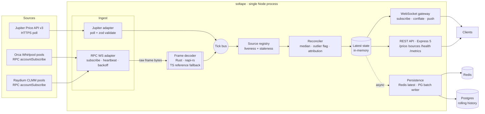

# High-Level Design: soltape

## Problem

Price data for a Solana token is spread across several venues, and every source is unreliable in its own way:

- **Aggregator APIs** (Jupiter) are convenient but sit behind HTTP polling and rate limits. They can lag, return errors, or fail without warning.
- **On-chain pools** (Orca Whirlpool, Raydium CLMM) are the ground truth, but the price is encoded inside raw account bytes (Q64.64 square-root prices, decimal scaling, venue-specific layouts). Updates come over an RPC WebSocket that can stall, drop, or silently stop delivering.
- **Any single source** can be stale, wrong, or offline at any moment.

A consumer that wants one trustworthy number per mint has to ingest every source, normalize them into the same units, notice which ones are stale or broken, and combine the rest. It has to do all of that fast enough that the consolidated price adds no meaningful delay on top of the network latency it already pays.

## Approach

soltape is a single Node/TypeScript service. It ingests prices from three sources, normalizes them into one schema, reconciles them into a consolidated price per mint with source attribution, and serves the result over REST and WebSocket. It records latency at every stage and publishes it.

### Node owns orchestration; Rust owns the CPU-bound decode

The service is TypeScript end to end: source connections, reconnect and backoff, failover, reconciliation, the REST and WebSocket APIs, and persistence to Redis and Postgres. Exactly one component is written in Rust and loaded into the Node process as a native addon via **napi-rs**: the **frame decoder**. It takes the raw bytes of an RPC WebSocket notification and returns a normalized tick. Inside that one call it parses the JSON-RPC envelope, base64-decodes the account data, validates the account (length, discriminator), decodes the venue-specific layout, and computes a decimal-adjusted price.

That one call is the only CPU-heavy work in the system, and it runs once per account update, at the highest message rate in the system. Doing it in Rust means hot-path frames never go through `JSON.parse`, never allocate intermediate JS strings or Buffers, and never add garbage-collector pressure that would show up as tail latency.

The Rust code is **pure**: bytes in, a tick or a typed error out. It does no I/O, holds no state, and catches panics at the FFI boundary. A bug in it can produce a rejected frame but cannot crash the process or deadlock it.

### A TypeScript reference decoder keeps Rust honest

A second implementation of the same decoder exists in TypeScript. It serves three purposes:

1. **Differential tests.** Both decoders run on the same recorded and fuzzed frames and must produce identical output.
2. **Evidence for using Rust.** A benchmark compares the two on throughput and tail latency, so the case for Rust rests on a measured number.
3. **Fallback.** If the native addon fails to load on some platform, the service starts on the TS decoder and logs a warning.

### Conflation over queueing

Market data is last-value-wins. Every buffer in the hot path (per-mint state, per-client outbound queues) keeps only the latest value instead of queueing. A slow WebSocket client gets the newest price when it next drains, not a backlog of old ones. This is how the service stays fast under load: memory and latency stay bounded however far behind a consumer falls.

### Persistence is off the hot path

The WebSocket push to clients happens first. The Redis write is fire-and-forget, and the Postgres history is written in batches. A slow or unavailable database degrades history, never the live feed.

### Reviewable with zero hosting

There is no hosted deployment and nothing to pay for. A reviewer can experience the system at three levels of effort:

- **Browse only.** The CI badge links to the Actions run. Its job summary shows test results and the replay benchmark's latency table, all rendered by GitHub with no setup.
- **One command, no credentials.** `docker compose up` pulls a prebuilt image and serves live mainnet prices from the public RPC. `docker compose --profile replay up` runs the full system offline against recorded frames.
- **Reproduce the numbers.** `pnpm bench` replays recorded traffic and prints the p99 along with the machine specs.

Everything the reviewer touches sits outside the hot path or runs in a separate mode, so none of it costs live-feed performance.

## Target Users

- **Trading and analytics services** that want one reconciled Solana spot price per mint with a published latency profile, without writing three venue integrations themselves.
- **Dashboards and bots** that subscribe over WebSocket and need to see staleness and source disagreement, not just a number.
- **Reviewers of this repository**, who should be able to clone it, run one command, and verify the latency claims with the included benchmark.

## Goals

1. **One consolidated price per mint**, reconciled from all fresh sources, with each contributing source named in the response.
2. **Latency that is measured and published.** Internal p99 from frame receipt to WebSocket write, and client-observed end-to-end p99, are both reported in the README and come from a reproducible benchmark. Target: internal p99 under 1 ms at 10k source updates/s with 1k WebSocket subscribers. This is a target until the optimization loop measures it.
3. **Graceful degradation.** Losing any one source, or any two, keeps the feed serving from what remains, clearly flagged. Losing Redis or Postgres never interrupts the live feed.
4. **Never crashes on bad input.** Malformed JSON, truncated accounts, unexpected layouts, and garbage frames are rejected, counted, and logged, never thrown into the event loop.
5. **Observable.** A Prometheus `/metrics` endpoint shows per-source update rate, ingest latency, staleness, decode errors, event-loop delay, and WebSocket fan-out lag.
6. **One-command deploy.** `docker compose up` starts the app, Redis, and Postgres. It pulls a prebuilt multi-arch image, and the Dockerfile still builds everything, including the native addon, from source.
7. **Reviewable in five minutes at zero cost.** No credentials are needed to run it. An offline replay mode always works. A built-in live page shows the feed. See KDD-12.

## Non-Goals

- **No trading.** No order placement, wallets, private keys, signing, or funds. The service is read-only.
- **No smart-contract deployment** and no on-chain writes.
- **No authentication or multi-tenancy.** It runs on localhost or a trusted network.
- **No hosting of any kind.** No deployed instance, no Pages site, no Vercel/Fly/Render, no paid infrastructure. It runs locally via Docker, and GitHub Actions is the only remote compute (CI and image builds to GHCR).
- **No paid data.** No Yellowstone/Geyser gRPC and no paid RPC tiers. The ingest abstraction lets a Geyser source plug in later, but nothing depends on one.
- **No multi-region HA or leader election.** One ingesting process. Redis makes horizontal read replicas possible but they are not built.
- **No settlement-grade correctness.** Prices come from `processed` commitment and can, rarely, reflect a slot that is later skipped. This is a market-data feed, not an oracle.
- **No core logic in Rust.** Rust is limited to the pure decode/normalize function. Moving orchestration, I/O, or reconciliation into Rust is out of scope by design.

## System Design

### Components

| Component | Responsibility |
|---|---|
| **Config** | Typed, zod-validated configuration: tracked mints, the pool accounts per venue, thresholds, RPC endpoints. Invalid config fails at startup, never at runtime. |
| **Source adapters** | One per source. Each owns its connection lifecycle (connect, subscribe, heartbeat, reconnect with jittered exponential backoff) and emits normalized ticks. The adapter interface is how a Geyser source or a perps venue would be added later. |
| **Frame decoder** (Rust) | Turns a raw notification frame into a normalized tick or a typed rejection. Pure and stateless. Has a TypeScript twin. |
| **Source registry** | Tracks each source's liveness and each (mint, source) observation's freshness. Decides which observations count. |
| **Reconciler** | Combines the fresh observations per mint into a consolidated price with attribution, and flags observations that disagree too much. |
| **Latest state** | In-memory per-mint state: consolidated price plus per-source breakdown. The process is the source of truth for "now". |
| **WebSocket gateway** | Handles client subscriptions to mints, pushes on change, and keeps one latest-value slot per client per mint under backpressure. |
| **REST API** | Express 5 routes reading from latest state: `GET /price/:mint`, `GET /sources/:mint`, `GET /health`, `GET /metrics`. |
| **Persistence** | A Redis latest-value writer (for warm restart and future read replicas) and a batched Postgres history writer with time-partitioned retention. |
| **Telemetry** | pino structured logs, prom-client metrics, stage timestamps carried on every tick. |
| **Live page** | A static, framework-free HTML page served at `/`. It is a plain WebSocket client of the gateway: a per-mint table of consolidated and per-source prices, stale and excluded flags, and live latency percentiles. |
| **Recorder & replay harness** | `pnpm record` captures real mainnet RPC frames and Jupiter responses into committed fixtures. The replay server stands in for the RPC endpoint and Jupiter at a controlled rate. It powers replay mode, the benchmark, and integration tests. It is a separate process and never runs inside the service. |

### Unified tick schema

Every source normalizes into one shape. These fields are fixed at HLD level; exact types are set in the LLDs.

- `mint`: the base token mint (base58).
- `price`: base priced in the **quote unit** (see Key Design Decisions), as a float64.
- `size`: optional liquidity measure in quote units. For CLMM pools it is depth estimated from active liquidity in a band around the current price. Jupiter provides none (null).
- `source`: a stable source identifier (e.g. `orca:<pool>`, `raydium:<pool>`, `jupiter`).
- `slot`: the Solana slot, for on-chain sources. Null for Jupiter.
- `sourceTime`: when the source says the value was true, if it says.
- `receivedAt`: wall-clock time the frame was received (for persistence and display).
- stage timestamps: monotonic, allocation-free timestamps per pipeline stage (receive, decode, reconcile, emit), used for latency metrics and never persisted. See `docs/llds/telemetry.md`.

### Consolidated price

For each mint: the median of the eligible (fresh, non-rejected) observations, the list of contributing sources, the list of excluded sources with the reason for each (stale, outlier, decode error, disconnected), the spread between the highest and lowest eligible observation, and a `degraded` flag set when fewer sources than configured are contributing.

## Key Design Decisions

### KDD-1: Single Node process with an in-process Rust addon (napi-rs)

**Chosen:** Node owns all I/O and orchestration. Rust is a napi-rs addon called synchronously from the RPC adapter's frame handler.

**Alternatives:**
- *Standalone Rust ingester streaming to Node over a Unix socket or shared memory.* Better crash isolation, but reconnects, backoff, failover, and subscription management (the work this project exists to show in Node) would move to Rust. It also adds a second process, an inter-process protocol, and a more complicated deploy.
- *All TypeScript with worker threads.* Simplest, but moving each frame to a worker and back costs more than the decode itself, and it gives up a measured reason for using Rust.

**Why:** Decoding is pure CPU work at the highest message rate in the system, so the gain from native code there is the most measurable. A synchronous napi call costs well under a microsecond in overhead, and the frame is passed by reference with no copy. Because the function is pure and catches panics, embedding it is safe. Every other piece of the system is I/O-bound, which is where Node's event loop is the right tool.

### KDD-2: Hand the Rust decoder the raw frame, not a decoded account

**Chosen:** The RPC adapter passes the WebSocket message bytes straight to Rust. Rust parses the JSON-RPC envelope, base64-decodes `data[0]`, and decodes the account. Node handles only the frames Rust classifies as "not an account notification" (subscription confirmations, errors).

**Alternative:** `JSON.parse` in Node, then pass the decoded account bytes to Rust.

**Why:** For a ~650–1,550-byte account, the expensive part is not the field reads. It is `JSON.parse` of the envelope, building the intermediate base64 string, and decoding it, and each of those allocates on the V8 heap. Doing all of it in one native pass is where Rust actually earns its place. If Rust only read fields, the FFI overhead would rival the work saved and the benchmark would show no gain.

### KDD-3: Sources: Jupiter + Orca Whirlpool + Raydium CLMM, two of them decoded on-chain

**Chosen:** Jupiter Price API v3 (HTTPS poll), plus Orca Whirlpool and Raydium CLMM pool accounts decoded directly from RPC `accountSubscribe`. Stretch goal: a Phoenix market account for real order-book depth.

Jupiter is **optional**. Its API (`api.jup.ag`) requires a free key, and the keyless `lite-api` host is deprecated. It turns on only when `JUPITER_API_KEY` is set. Without a key, `/health` reports it as *disabled*, not *failed*, and the two on-chain sources run on the keyless public RPC.

**Alternatives:** Venue REST APIs for Orca and Raydium (easier, but slower, rate-limited, and no on-chain work); Pyth price accounts (an oracle, not a venue, and it would make reconciliation circular).

**Why:**
- Two independent on-chain decoders show real command of Solana's account model (owner programs, Anchor discriminators, Q64.64 square-root prices, decimal scaling) and give the Rust decoder two layouts to handle.
- Jupiter adds an off-chain aggregate as a cross-check.
- Its correlation with the pools (Jupiter partly derives prices from them) is acknowledged: it is the reason reconciliation uses the median and not a mean.

### KDD-4: Staleness means proven liveness, not time since last change

**Chosen:** An on-chain pool account only changes when someone trades against it. A quiet pool's price is unchanged and still correct, as long as we can prove we would have heard about a change. So freshness has two parts:

- **Source liveness.** For RPC sources, a `slotSubscribe` stream on the same connection must keep advancing within a threshold. For Jupiter, the last poll must have succeeded within a threshold.
- **Observation validity.** An observation counts as fresh while its source is live. It also has a hard age limit, so a subscription that silently stopped delivering for one account while the connection stays healthy is still caught.

**Alternative:** "Exclude anything older than N seconds since its last update." That would wrongly drop quiet but correct pools and count them as failures.

**Why:** This is the difference between "the data is old" and "we can no longer vouch for the data", and only the second is a reason to exclude a source.

### KDD-5: Median reconciliation with outlier flagging

**Chosen:** The consolidated price is the median of eligible observations. An observation more than a configured number of basis points from the median of the others is flagged as an outlier and excluded. With two sources the result is their midpoint, plus a disagreement flag if they diverge past the threshold. With one source it is that value with `degraded: true`.

**Alternatives:**
- *Liquidity-weighted mean.* A shallow pool that has been manipulated still moves a mean, and Jupiter has no liquidity figure to weight by.
- *Best bid/offer.* Needs real bid and ask, which CLMM pools and Jupiter don't provide. Revisited if the Phoenix stretch lands.

**Why:** The median tolerates one bad source out of three. That is exactly the failure model, since any one source can be wrong.

### KDD-6: Quote unit is USDC; composite routes are explicit

**Chosen:** Every price is "base per USDC". Each (mint, venue) pair is configured to a direct X/USDC pool where one exists, or a composite route (X/SOL × SOL/USDC) that names both legs in its attribution. USDC is the numeraire and is not itself priced by the feed. Jupiter's USD price is converted by dividing by Jupiter's own USDC price, so all three sources share one unit.

**Alternative:** Assume USDC = $1 and report USD.

**Why:** It is a hidden assumption that silently breaks during a depeg. Making the numeraire explicit keeps every number honest about what it measures.

### KDD-7: `processed` commitment for subscriptions

**Chosen:** `processed`, configurable.

**Alternative:** `confirmed`, which adds about one to two slots (≈400–800 ms) of delay.

**Why:** For a market-data feed, that delay is worse than the rare skipped-slot price, and the error corrects itself on the next update. The slot is carried on every tick so consumers can apply their own policy. Settlement-grade use is a non-goal.

### KDD-8: Conflated, backpressure-aware WebSocket fan-out

**Chosen:** The `ws` library with `permessage-deflate` disabled. Pushes happen on consolidated-price change. Each client has one latest-value slot per mint, and a client is skipped while its `bufferedAmount` is above a high-water mark. Clients that stay slow past a limit are disconnected. Outbound frames are serialized once per update and the same buffer is reused for every subscriber.

**Alternatives:**
- *uWebSockets.js:* faster, but not a standard npm package. Kept as a candidate for the optimization loop if `ws` shows up in the profile.
- *socket.io:* adds protocol overhead the service doesn't need.

**Why:**
- Unbounded per-client queues are the classic backpressure collapse. Conflation bounds memory and latency per client.
- Compression costs CPU and adds latency for frames of only about 200 bytes.

### KDD-9: Latest state in memory; Redis as shared snapshot; Postgres as batched, partitioned history

**Chosen:**
- **REST and WebSocket** read the in-process state directly.
- **Redis** gets the latest consolidated and per-source values, written fire-and-forget. It is used for warm restart (serve the last known state, flagged stale, immediately on boot) and so future read replicas could serve without ingesting.
- **Postgres** gets every observation and consolidated update via a batch writer that flushes on size or interval, using multi-row inserts. Tables are partitioned by day, and retention is enforced by dropping partitions rather than `DELETE`.

**Alternative:** Reading from Redis on the request path. That adds a network round trip to every read and buys nothing in a single process.

**Why:** Each store does the one job it is good at, and neither is on the hot path. Dropping a partition costs the same however many rows it holds, where a rolling `DELETE` bloats the table and fights autovacuum.

### KDD-10: Latency measured in two places, with HDR histograms

**Chosen:**
- **Internal latency:** every tick carries monotonic stage stamps (`performance.now()`, which doesn't allocate, unlike `hrtime.bigint()`). Receive → decoded → reconciled → written to the socket is recorded in prom-client histograms.
- **End-to-end benchmark:** a replay harness serves recorded real mainnet frames from a local fake RPC server at a controlled rate (up to well past live rates), while a load-generating client counts how many WebSocket subscribers it holds. Client-side receive time minus the replay stamp goes into an HDR histogram.
- **Live run:** the same measurements against mainnet, reported separately.
- **README:** reports both, with machine specs and exact commands.

**Why:** Live mainnet rates are too low and too uneven to stress the system, and the free public RPC also throttles account notifications (measured: a few per pool per 15 s, against per-slot trading). Live mode therefore shows correctness and resilience, and replay mode carries the latency claims. Replay makes the p99 reproducible and lets the load be pushed until it breaks, and the breaking point is the honest throughput number. Event-loop delay (`monitorEventLoopDelay`) is exported so a reader can see when the event loop itself becomes the bottleneck.

### KDD-12: Reviewable in five minutes, at zero hosting cost

**Chosen:**
- **No credentials by default.** On-chain sources use the public mainnet RPC. Jupiter and a custom RPC URL are optional environment variables.
- **Two run modes.**
  - `docker compose up` serves live mainnet.
  - `docker compose --profile replay up` runs the unchanged service against the replay server, fully offline. It works when the public RPC is rate-limited or down.
- **A prebuilt image.** GitHub Actions builds a multi-arch (amd64 + arm64) image and publishes it to GHCR, so a reviewer never waits on a Rust compile.
- **CI on every push.**
  - TypeScript typecheck and lint, then unit tests.
  - Rust tests and a time-boxed fuzz run.
  - Rust/TS decoder comparison.
  - Integration tests against real Postgres and Redis via testcontainers.
  - A short replay benchmark.
- **CI results in the job summary.** The benchmark writes its p50/p99/p99.9 table and the Rust-vs-TS decoder comparison to `$GITHUB_STEP_SUMMARY`, and the raw HDR histograms are uploaded as artifacts.
- **No-Docker development.** `pnpm dev` with only Node and pnpm. If the native addon isn't built, the TS reference decoder takes over, so contributors don't need Rust.
- **Offline tests.** Unit and decoder tests run on committed fixtures. Integration tests need only Docker.

**Alternatives:**
- *A free-tier hosted deployment or static demo site* (Fly.io, Render, Vercel, Pages): something to configure and maintain, outside the brief. The server free tiers also sleep, cap resources, and change terms. A cold-started, throttled instance would make the latency story look worse than the local run, and it is an ongoing thing to babysit.
- *Live-only mode:* the demo would depend on a public RPC that rate-limits and has outages.

**Why:**
- A reviewer gives a repo a few minutes. Each level, from browsing to one command to reproducing the numbers, works on its own, so even the lowest-effort look shows the system running.
- Performance cost is none:
  - The live page is one more WebSocket subscriber, and the gateway is built for 1k.
  - Static files are served by Express outside the hot path.
  - Replay is a separate process.
  - CI never touches a running service.

**Caveat:** GitHub-hosted runners are shared VMs with noisy neighbours. CI benchmark numbers are for spotting regressions only. The headline README numbers come from a documented local machine, and both are labelled that way.

### KDD-11: Stack

| Choice | Over | Why |
|---|---|---|
| **Node 24 LTS, TypeScript strict, ESM** | Bun, Deno | The target stack. Current LTS. napi-rs support is first-class. |
| **Express 5** | Fastify | REST is not the hot path (the WebSocket is), and REST reads from memory. Express 5 matches the target team's stack and now handles async errors natively. Router overhead is measured, and if it ever shows in the p99, Fastify is a contained swap behind the route layer. |
| **ws** | uWS.js, socket.io | See KDD-8. |
| **napi-rs** | neon, WASM | napi-rs gives the best TS type generation, prebuilt-binary workflow, and Buffer-by-reference support. WASM can't avoid copying across the boundary and runs slower than native for parsing work. |
| **Awilix** | tsyringe, manual wiring | Constructor injection with no decorators or reflect-metadata, scoped lifetimes, and easy swapping of real and fake sources in integration tests. |
| **Postgres + Drizzle** | Prisma, Kysely | Drizzle is SQL-first, generates no client, and is typed close to the SQL. Custom migrations handle partitioning, which no ORM models well. |
| **Redis (ioredis)** | node-redis | Mature pipelining and auto-reconnect behavior that matters during failover tests. |
| **zod** | hand-rolled guards | Validates config and untrusted Jupiter JSON at the boundary. Never used in the RPC hot path (that is Rust's job). |
| **pino** | winston | Lowest-overhead structured logger for Node. Logging happens asynchronously off the main thread. |
| **prom-client** | OpenTelemetry | Directly provides the requested Prometheus `/metrics` with far less setup. |
| **Vitest + testcontainers + fast-check** | Jest | Fast, ESM-native tests. Integration tests run against real Postgres and Redis. Property-based tests cover reconciliation. |
| **cargo-fuzz + proptest (Rust)** | — | The decoder handles untrusted bytes, so fuzzing it is required, not optional. |
| **pnpm** | npm, yarn | Strict dependency isolation and a workspace for the TS package plus the native addon package. |

## Success Metrics

- **Latency:** the README shows internal and end-to-end p50/p99/p99.9 from the replay benchmark, plus a live mainnet run. *Falsification:* internal p99 above 1 ms at the stated load, or numbers that the documented commands can't reproduce.
- **Rust justification:** the decoder benchmark shows a clear gain for Rust over the TS reference in throughput and in p99 under GC pressure. *Falsification:* no meaningful gain. In that case the README says so and the design is revisited, not hidden.
- **Throughput:** the replay benchmark finds the update rate at which p99 or event-loop delay degrades, and reports it. *Falsification:* memory grows without limit, or latency degrades past the knee instead of conflating.
- **Resilience:**
  - Killing any one or two sources mid-run keeps every mint served, with correct `degraded` and exclusion attribution.
  - Killing Redis or Postgres doesn't affect WebSocket latency.
  - Fuzzed frames never crash the process.
  - *Falsification:* any crash, unhandled rejection, or silently stale price served as fresh.
- **Correctness:** decoded on-chain prices match each venue's own SDK price on recorded fixtures to within float tolerance, and the Rust and TS decoders agree exactly on the same fixtures.
- **Deployability:** a fresh clone with only Docker installed shows live prices at `http://localhost:<port>/` within five minutes of `docker compose up`, with no credentials and no Rust compile. Replay mode does the same with the network disconnected.
- **Reviewability:** the CI badge (linking to a job summary with the benchmark table) is at the top of the README, and `pnpm bench` in replay mode reproduces the README's p99 within a tolerance stated next to the numbers. *Falsification:* any step in the README that requires a sign-up, a paid service, or an undocumented manual action.

## FAQ

**Why not write the whole thing in Rust, if speed matters?** Because the latency budget is dominated by the network (RPC push timing, slot cadence), not by orchestration. Rust goes where CPU is the bottleneck, and the benchmark shows exactly how much it buys. Everything else is I/O-bound, where Node is the right tool.

**Why include Jupiter if it partly derives from the same pools?** It is an independent pipeline (different infrastructure, routing, and failure modes), so it catches our own decode bugs and RPC stalls. The correlation is why reconciliation uses the median.

## References

- Orca Whirlpools program and account layout: `whirLbMiicVdio4qvUfM5KAg6Ct8VwpYzGff3uctyCc`
- Raydium CLMM program and `PoolState` layout: `CAMMCzo5YL8w4VFF8KVHrK22GGUsp5VTaW7grrKgrWqK`
- Jupiter Price API v3 documentation: https://developers.jup.ag/docs/price/v3 (an API key is required on `api.jup.ag`; the `lite-api` host is deprecated)
- Solana JSON-RPC WebSocket API: `accountSubscribe`, `slotSubscribe`
- napi-rs documentation
- HdrHistogram (Gil Tene): coordinated omission and latency measurement
